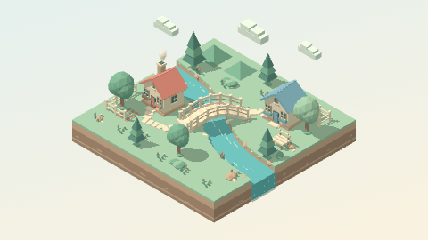
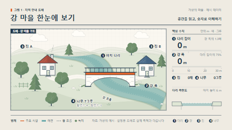

# BangMotion Visual Director

수업용·설명용·홍보용 **모션그래픽 제작 에이전트 스킬**입니다. Claude Code, Codex, Antigravity에서 같은 파일로 동작합니다.

그래픽 스타일 도감(실제 코드로 만든 5초 데모 8종) → BangMotion 연출기법 선택 → 그래픽 품질 디렉터 설계 → HTML 구현 → 프레임 검증 → MP4 순서로 진행합니다.

| 01 아이소메트릭 | 02 스타일라이즈드 3D | 03 동화풍 2.5D | 04 플랫 벡터 |
|---|---|---|---|
|  |  |  |  |
| **05 페이퍼 컷아웃** | **06 미니어처 디오라마** | **07 인포그래픽 모션** | **08 글래스모피즘 / 시네마틱 UI** |
|  |  |  |  |

미리보기는 모두 실제 데모 코드를 브라우저에서 렌더링해 추출한 것입니다(이미지 생성 AI 미사용). 8종 모두 같은 장면(강·다리·집 2채·나무)을 그려 스타일 차이만 비교됩니다.

## 준비물
- Node.js 18 이상
- Chrome 또는 Edge (프레임 캡처·검증용)
- ffmpeg (MP4·GIF를 만들 때만, 예: `winget install Gyan.FFmpeg`)

## 설치
```bash
git clone https://github.com/kimmokdong/bangmotion-visual-director.git
cd bangmotion-visual-director
node scripts/install.js            # Claude Code·Codex·Antigravity 모두
node scripts/install.js --codex    # 하나만: --claude / --codex / --antigravity
```
`install.js`는 아래 위치로 복사하고 `scripts/`에서 `npm install`(playwright-core)까지 실행합니다.

| 에이전트 | 설치 위치 |
|---|---|
| Claude Code | `~/.claude/skills/bangmotion-visual-director/` |
| Codex | `~/.codex/skills/bangmotion-visual-director/` |
| Antigravity | `~/.gemini/config/skills/bangmotion-visual-director/` |

직접 복사해도 됩니다. 그 경우 설치 폴더의 `scripts/`에서 `npm install`을 한 번 실행하세요. 설치 후 에이전트를 새로 열면 스킬이 인식됩니다.

## 사용
- "화산 폭발 과정을 20초 모션그래픽으로 만들어 줘" → 스타일 갤러리가 열리고, 번호를 고르면 제작
- "아이소메트릭 스타일로 물의 순환 과정 만들어 줘" → 갤러리 없이 바로 제작
- "지구와 달의 운동 15초, 스타일은 알아서" → 주제에 맞게 자동 선택
- "만든 영상에서 구름이 더 빨리 사라지게 해 줘" → 기존 영상 수정

갤러리만 열기:
```bash
node scripts/serve.js --open
```
카드를 눌러 5초 데모를 보고 **이 스타일로 선택**을 누르면 `스타일 선택: <id>` 문구가 나옵니다. 그 문구를 에이전트에게 말하거나 "골랐어"라고 하면 에이전트가 선택 파일을 읽습니다.

## 폴더 구성
| 경로 | 내용 |
|---|---|
| `SKILL.md` | 스킬 진입점(에이전트가 읽는 지침) |
| `references/` | 제작 워크플로, 스타일 도감, BangMotion 연출기법 라이브러리, 그래픽 품질 디렉터, 렌더링 가이드 |
| `styles/NN-id/` | 스타일 데모(`index.html`, `demo.js`), `style.json`, `notes.md`, `preview.png`/`.gif` |
| `styles/CONTRACT.md` | 데모·영상 공통 재생 계약(`render(t)` 순수 함수) |
| `shared/runtime.js` | 재생 시계(seek, `?t=`, postMessage 제어) |
| `vendor/three/` | three.js r170 로컬 사본(외부 CDN 없이 동작) |
| `gallery/` | 스타일 선택 화면 |
| `scripts/` | `serve` / `validate-demo` / `create-contact-sheet` / `capture-previews` / `render-demo` / `install` |
| `templates/` | 수업 도입, 개념 설명, 시네마틱 인트로, 인포그래픽 뼈대 |

## 스크립트
```bash
node scripts/validate-demo.js                     # 8종 데모 자동 검사
node scripts/validate-demo.js --url ./my/index.html --duration 20 --no-loop
node scripts/create-contact-sheet.js --url ./my/index.html --duration 20
node scripts/render-demo.js --url ./my/index.html --out out.mp4 --fps 30 --thumbnail 3
node scripts/capture-previews.js                  # 스타일 미리보기 재생성
```

## 에이전트별 참고
- 에이전트에게 필요한 기능: 셸 명령 실행, 파일 읽기·쓰기, 이미지 보기(시각 검증).
- ChatGPT·Gemini **웹 채팅**에서는 로컬 브라우저·서버·ffmpeg를 돌릴 수 없으므로 문서를 참고 자료로만 쓸 수 있습니다.

## 출처와 라이선스
- 이 저장소: MIT License (`LICENSE`)
- `references/bangmotion-directing-library.md`는 [bang-motion](https://github.com/bangtutorial/bang-motion)(© Bang Tutorial, MIT)의 문서를 읽고 정리한 것입니다. 원문에 없는 내용은 `[보충]`으로 표시했습니다.
- `vendor/three/`: [three.js](https://threejs.org)(© three.js authors, MIT)
- 그래픽 품질 디렉터의 수치·적용표는 이 프로젝트에서 새로 설계했습니다.

자세한 고지는 `NOTICE.md`에 있습니다.
