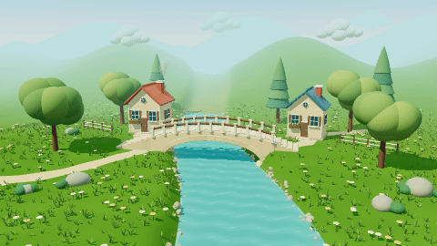
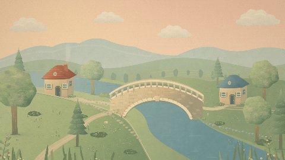
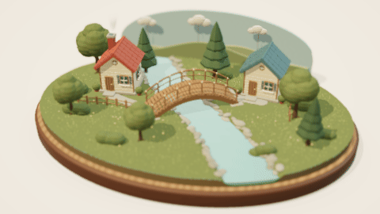
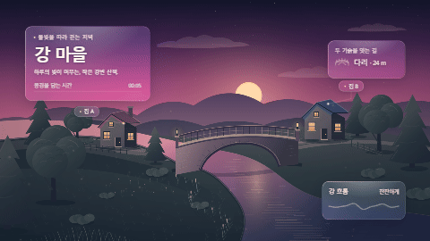

# BangMotion Visual Director

수업용·설명용·홍보용 **모션그래픽 제작 에이전트 스킬**입니다. Claude Code, Codex, Antigravity에서 같은 파일로 동작합니다.

스타일 선택 → 장면·연출·품질·소리 설계 → HTML 구현과 프레임 검증 → HTML 초안 검토와 수정 → 완성본 상영 순서로 진행합니다.

## 선생님용 한 장 안내

**1. 처음 한 번 — 설치**
에이전트(Claude Code·Codex·Antigravity)에게 아래 문장을 그대로 붙여 넣으면 됩니다.

```text
https://github.com/kimmokdong/bangmotion-visual-director 저장소를 받아서, README의 설치 방법대로 node scripts/install.js 까지 실행해서 스킬을 설치해 줘. 설치가 끝나면 scripts 폴더에 esbuild와 playwright-core가 깔렸는지 확인해 줘.
```

직접 하려면 아래 [설치](#설치)의 명령을 실행합니다. 설치 후 에이전트를 새로 엽니다. 폴더만 복사해서 필요한 패키지가 빠졌더라도, 처음 영상을 만들 때 스크립트가 알아서 한 번 설치합니다(인터넷 연결 필요).

**2. 작업 폴더 하나 만들기**
바탕화면에 `영상 만들기` 같은 폴더를 하나 만들고, 에이전트에서 그 폴더를 엽니다. 영상마다 하위 폴더(`손바느질/`, `물의 순환/` …)는 에이전트가 알아서 만듭니다.

**3. 말로 요청하기**
"6학년 실과 바느질 방법을 따라 할 수 있는 모션그래픽 만들어 줘"처럼 말합니다. 스타일 갤러리가 열리면 번호만 고릅니다. 수업·설명 영상이면 설명 방식(음악·효과음만 / 내레이션 / 소리 없음)을 함께 묻습니다.

**4. 초안 보고 말로 고치기**
하위 폴더의 `preview.html`을 더블클릭하면 소리와 함께 영상처럼 재생됩니다.
- Space 재생·정지 · ←/→ 한 프레임 · 1~9 장면만 반복 · M 소리 · 0.25/0.5배속
- 고칠 곳에서 **C**를 누르면 "23.4초 · 702프레임 (3. 홈질)"이 복사됩니다. 그대로 붙여 넣고 "여기서 바늘이 더 천천히 움직이게"처럼 말하면 됩니다.
- 에이전트가 고쳤다고 하면 **R**을 눌러 다시 봅니다.

**5. 완성본 쓰기**
- **수업에서 틀기**: **⛶ 상영**(F) → 처음부터 전체화면으로 재생, Space로 잠깐 멈추고 설명, Esc로 나가기.
- **영상 파일이 필요할 때**(패들렛·유튜브·메신저): **● 영상으로 저장** → Chrome 공유창에서 **이 탭**과 **탭 오디오도 공유**를 고르고 **⛶ 상영하며 녹화 시작**을 한 번 더 누르면, 영상 길이만큼 재생한 뒤 파일이 내려받아집니다(Chrome 버전에 따라 MP4 또는 WebM).
- 녹화 버튼이 안 되면 Windows 캡처 도구(**Win+Shift+R**)나 Xbox Game Bar(**Win+Alt+R**)로 녹화해도 됩니다. PC가 느려 녹화가 끊기거나 정확한 고화질 MP4가 필요하면 에이전트에게 "MP4로 구워 줘"라고 하세요(`render-demo.js`, 시간이 오래 걸립니다).
- **다른 사람에게 줄 때**: `preview.html` 한 파일만 주면 됩니다. 소리도 파일 안에 들어 있습니다.

**알아 둘 점**
- 나중에 고치려면 하위 폴더를 지우지 마세요. `index.html`·`video.js`·`sound.json` 같은 작업 파일이 있어야 에이전트가 이어서 고칠 수 있습니다. `preview.html`은 완성본 사본입니다.
- Chrome 또는 Edge(PC)로 여세요. 휴대폰에서도 보기는 대체로 되지만 전체화면·녹화는 제한될 수 있습니다.
- 배경음악·효과음의 출처와 라이선스는 하위 폴더의 `out/sound/SOUND.md`·`CREDITS.txt`에 적힙니다. 공개하기 전에 한 번 확인하세요.

| 01 아이소메트릭 | 02 스타일라이즈드 3D | 03 동화풍 2.5D | 04 플랫 벡터 |
|---|---|---|---|
|  |  |  |  |
| **05 페이퍼 컷아웃** | **06 미니어처 디오라마** | **07 인포그래픽 모션** | **08 글래스모피즘 / 시네마틱 UI** |
|  |  |  |  |

미리보기는 모두 실제 데모 코드를 브라우저에서 렌더링해 추출한 것입니다(이미지 생성 AI 미사용). 8종 모두 같은 장면(강·다리·집 2채·나무)을 그려 스타일 차이만 비교됩니다.

## 준비물

- Chrome 또는 Edge와 제작 에이전트
- Node.js 18 이상 (설치·자동 검사·번들)
- ffmpeg (선택, 정확한 음량 믹스 및 고품질 MP4·GIF 출력용, 예: `winget install Gyan.FFmpeg`)

## 설치
```bash
git clone https://github.com/kimmokdong/bangmotion-visual-director.git
cd bangmotion-visual-director
node scripts/install.js            # Claude Code·Codex·Antigravity 모두
node scripts/install.js --codex    # 하나만: --claude / --codex / --antigravity
```
`install.js`는 아래 위치로 복사하고 `scripts/`에서 `npm install`(playwright-core, esbuild)까지 실행합니다.

| 에이전트 | 설치 위치 |
|---|---|
| Claude Code | `~/.claude/skills/bangmotion-visual-director/` |
| Codex | `~/.codex/skills/bangmotion-visual-director/` |
| Antigravity | `~/.gemini/config/skills/bangmotion-visual-director/` |

직접 복사해도 됩니다. 그 경우 설치 폴더의 `scripts/`에서 `npm install`을 한 번 실행하세요. 설치 후 에이전트를 새로 열면 스킬이 인식됩니다.

## 사용
- "화산 폭발 과정을 20초 모션그래픽으로 만들어 줘" → 스타일 갤러리가 열리고, 번호를 고르면 제작
- "아이소메트릭 스타일로 물의 순환 과정 만들어 줘" → 갤러리 없이 바로 제작
- "지구와 달의 운동 15초, 스타일은 알아서" → 주제에 맞게 자동 선택
- "만든 영상에서 구름이 더 빨리 사라지게 해 줘" → 기존 영상 수정

갤러리만 열기:
```bash
node scripts/serve.js --open
```
카드를 눌러 5초 데모를 보고 **이 스타일로 선택**을 누르면 `스타일 선택: <id>` 문구가 나옵니다. 그 문구를 에이전트에게 말하거나 "골랐어"라고 하면 에이전트가 선택 파일을 읽습니다.

## 소리

`templates/sound.json`을 프로젝트에 복사해 음악, 효과음 큐와 출처를 채웁니다. `node scripts/sound.js <프로젝트>`가 믹스·크레딧·파형을 만들고, `render-demo.js`가 MP4에 오디오를 넣은 뒤 음량을 다시 잽니다. 무음으로 내보낼 때는 `--no-sound`를 사용합니다. [소리 가이드](references/sound-guide.md)

## 미리보기

`node scripts/bundle-preview.js <프로젝트>`로 `preview.html`을 만듭니다. 조작 막대에서 Space로 재생·정지하고, 1~9로 장면을 반복하거나 C로 시각·프레임을 복사해 수정 요청에 붙입니다. 초안이 갱신되면 R을 누릅니다.

## 폴더 구성
| 경로 | 내용 |
|---|---|
| `SKILL.md` | 스킬 진입점(에이전트가 읽는 지침) |
| `references/` | 제작 워크플로, 스타일 도감, BangMotion 연출기법 라이브러리, 그래픽 품질 디렉터, 렌더링 가이드 |
| `styles/NN-id/` | 스타일 데모(`index.html`, `demo.js`), `style.json`, `notes.md`, `preview.png`/`.gif` |
| `styles/CONTRACT.md` | 데모·영상 공통 재생 계약(`render(t)` 순수 함수) |
| `shared/runtime.js` | 재생 시계(seek, `?t=`, 갤러리 제어)와 선택 오디오 |
| `sound/` | CC0 효과음 라이브러리와 출처 |
| `vendor/three/` | three.js r170 로컬 사본(외부 CDN 없이 동작) |
| `gallery/` | 스타일 선택 화면 |
| `scripts/` | `serve` / `validate-demo` / `create-contact-sheet` / `capture-previews` / `sound` / `bundle-preview` / `render-demo` / `install` |
| `templates/` | 수업 도입, 개념 설명, 시네마틱 인트로, 인포그래픽 뼈대와 장면·소리 설정 예시 |

## 스크립트
```bash
node scripts/validate-demo.js                     # 8종 데모 자동 검사
node scripts/validate-demo.js --url ./my/index.html --duration 20 --no-loop
node scripts/create-contact-sheet.js --url ./my/index.html --duration 20
node scripts/render-demo.js --url ./my/index.html --out out.mp4 --fps 30 --thumbnail 3
node scripts/capture-previews.js                  # 스타일 미리보기 재생성
```

## 에이전트별 참고
- 에이전트에게 필요한 기능: 셸 명령 실행, 파일 읽기·쓰기, 이미지 보기(시각 검증).
- ChatGPT·Gemini **웹 채팅**에서는 로컬 브라우저·서버·ffmpeg를 돌릴 수 없으므로 문서를 참고 자료로만 쓸 수 있습니다.

## 출처와 라이선스
- 이 저장소: MIT License (`LICENSE`)
- `references/bangmotion-directing-library.md`는 [bang-motion](https://github.com/bangtutorial/bang-motion)(© Bang Tutorial, MIT)의 문서를 읽고 정리한 것입니다. 원문에 없는 내용은 `[보충]`으로 표시했습니다.
- `vendor/three/`: [three.js](https://threejs.org)(© three.js authors, MIT)
- 그래픽 품질 디렉터의 수치·적용표는 이 프로젝트에서 새로 설계했습니다.

자세한 고지는 `NOTICE.md`에 있습니다.
